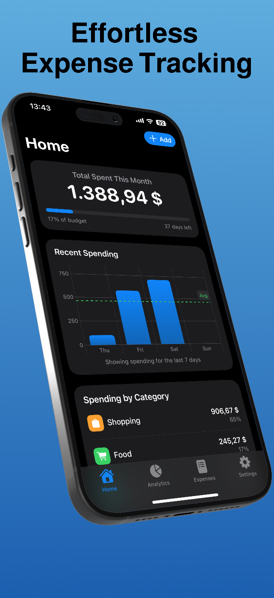
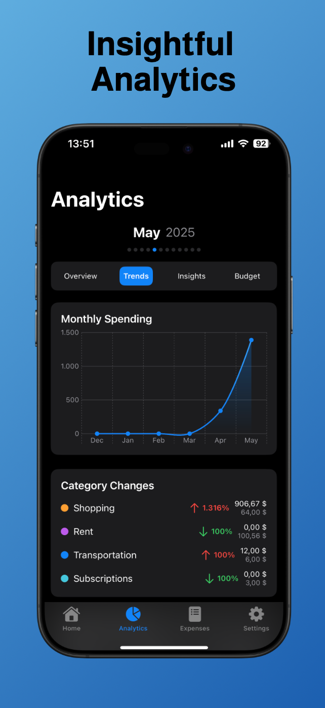
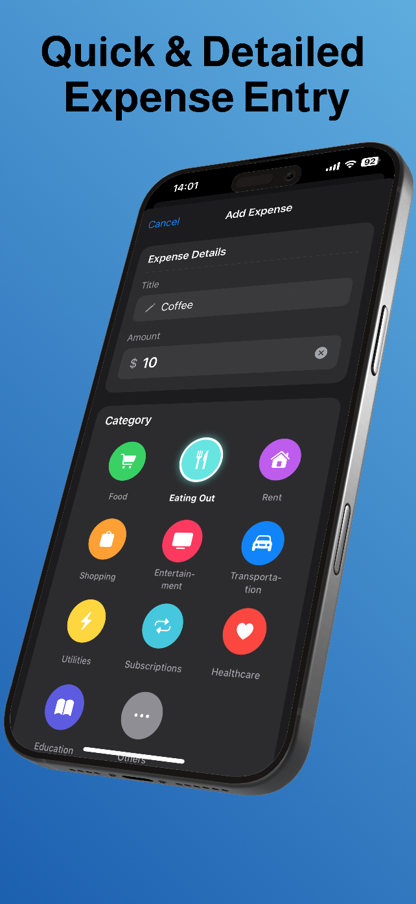

# Inpenso

<p align="center">
  <kbd>
    
  </kbd>
</p>

A modern, intuitive expense tracker for iOS that helps you monitor spending, set budgets, and visualize your financial habits through beautiful analytics.

## Features

- **Smart Analytics**: Visualize your spending patterns by category, month, and trends
- **Budget Management**: Set a monthly budget that carries over to later months until you change it, plus optional per-category limits
- **Income & Expenses**: Track money in and out, with built-in and custom categories
- **Wallets**: Keep separate balances for cash, bank accounts and e-wallets. Move money between them with transfers, and record a transfer fee if there is one. Fees count as spending, but the transfer itself doesn't
- **Recurring Transactions**: Schedule repeating income such as a monthly salary, or repeating bills. Due items appear on the Home screen for you to confirm
- **Multi-Currency**: Supports many currencies, including currencies with no decimal places such as Indonesian Rupiah (IDR) and Japanese Yen. Amounts are grouped as you type
- **Backup & Export**: Export a full backup and restore it later by merging or replacing your data, or export your transactions to CSV
- **Home Screen Widgets**: Monitor your expenses directly from your home screen
- **iOS Integration**: Clean SwiftUI design that follows Apple's HIG
- **Siri Shortcuts**: Add expenses quickly with voice commands
- **Privacy-Focused**: All your data stays on your device

## Screenshots

<table>
  <tr>
    <td></td>
    <td></td>
    <td></td>
  </tr>
</table>

## Requirements

- iOS 16.0+
- Xcode 15.0+
- Swift 5.9+

## Installation

1. Clone the repository:
```bash
git clone https://github.com/VintusS/Inpenso.git
```

2. Open `Inpenso.xcodeproj` in Xcode.

3. To run on a device with your own Apple developer team, set up local signing (optional for the simulator):
```bash
cp Config/Signing.local.xcconfig.example Config/Signing.local.xcconfig
```
Fill in your team ID, a unique bundle ID and an app group ID. This file is gitignored, so your signing details stay out of commits. If you skip this step, the project builds with the defaults in `Config/Signing.xcconfig`.

4. Build and run the app on your iOS device or simulator.

## Architecture

Inpenso follows the MVVM (Model-View-ViewModel) architecture pattern:

- **Models**: Data structures representing transactions, categories, wallets, transfers and recurring rules
- **Views**: SwiftUI views for user interface
- **ViewModels**: Business logic that connects models to views
- **Services**: Handles data persistence, wallet balances, recurring schedules, backup and CSV export

All data is stored in one versioned file in the app group container, so the app, the widget and Siri all read the same data. Wallet balances are calculated from transactions and transfers instead of being stored.

## Contributing

Contributions are welcome! If you'd like to contribute, please follow these steps:

1. Fork the repository
2. Create your feature branch (`git checkout -b feature/amazing-feature`)
3. Commit your changes (`git commit -m 'Add some amazing feature'`)
4. Push to the branch (`git push origin feature/amazing-feature`)
5. Open a Pull Request

Please read the [CONTRIBUTING.md](CONTRIBUTING.md) for details on our code of conduct and the process for submitting pull requests.

## License

This project is licensed under the MIT License - see the [LICENSE](LICENSE) file for details.

## Acknowledgments

- Thanks to all contributors who have helped shape Inpenso
- Icons provided by SF Symbols
- Inspiration from other personal finance apps

## Contact

Dragomir Mindrescu - [@VintusS](https://github.com/VintusS)

Project Link: [https://github.com/VintusS/Inpenso](https://github.com/VintusS/Inpenso)

## Topics

ios swift swiftui expense-tracker personal-finance budget-app analytics data-visualization mobile-app productivity tools
